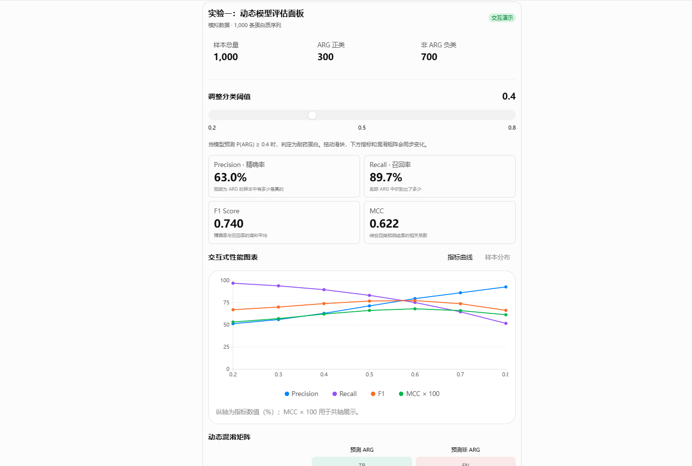

# GPT-WebExporter

中文 · [English](README.en.md)

一键将当前 ChatGPT 对话导出为单文件 HTML，保留原版样式、图片、字体和 Intelligent UI 交互。下载后用浏览器打开，即可离线阅读、拖动滑块、切换图表、完成测验。



[下载扩展](https://github.com/Nova42x/GPT-WebExporter/releases/latest) · [实现设计](DESIGN.md)

## 功能

- **一键导出**：点击浏览器工具栏按钮，自动生成并下载“当前会话标题.html”。
- **保留原版视觉效果**：保存正文排版、CSS、主题、代码高亮、图片、字体和 SVG 图标。
- **离线交互**：将交互程序和运行时嵌入 HTML，打开文件即可操作。
- **联动图表**：支持阈值滑块、指标卡、图表切换、折线图、柱状图和动态混淆矩阵。
- **交互式学习**：支持 SQL 查询流程、数据表切换、索引、Buffer Pool、MVCC、锁区间与死锁时间线演示。
- **测验与解析**：支持单选、多选、判断题，以及提交评分、查看解析、重新作答和 LearningQuiz 卡片。
- **阅读工具**：支持代码复制与自动换行、附件图片放大、引用来源展示和后续提示词查看。
- **当前会话采集**：按真实消息 ID 保存当前选中分支中已加载的消息，包括屏幕之外的已加载内容。
- **状态还原**：恢复已保存的测验状态，以及可明确映射的当前滑块值和切换选项；打开文件时从导出快照或组件初始状态开始。
- **导出报告**：展示消息数量、交互回答数量、资源保存结果和提示信息。

## 安装与使用

适用于 Microsoft Edge 和 Google Chrome。

1. 在[发布页](https://github.com/Nova42x/GPT-WebExporter/releases/latest)下载扩展 ZIP，解压到固定目录。
2. Edge 打开 `edge://extensions`，Chrome 打开 `chrome://extensions`。
3. 开启“开发人员模式”，点击“加载解压缩的扩展”，选择包含 `manifest.json` 的目录。
4. 打开需要保存的 ChatGPT 对话，等待回答生成完成。长对话先滚动加载需要保存的内容。
5. 点击工具栏中的 **GPT-WebExporter**。导出进度在新标签页显示，完成后自动下载 HTML。
6. 用 Edge 或 Chrome 打开下载的文件，即可离线阅读和操作交互组件。

导出期间保持原对话打开，等下载开始后再关闭进度页。可通过导出报告核对消息数量及资源保存结果。“继续下一阶段”等按钮提供原始提示词，方便复制并在原对话中继续；来源链接可直接打开对应网页。

更新扩展时，将安装目录替换为新版文件，并在扩展管理页点击“重新加载”。重新导出即可生成使用新版本的 HTML。

## 本机运行

采集、资源内嵌和 HTML 生成均在本机完成。扩展使用当前页面的数据和当前登录会话读取所选对话，在导出期间临时采集该对话的 JSON 响应，结束后清理采集桥。

样式、字体和图片存入 HTML。每条交互回答在独立沙箱中运行，权限限定为本地脚本执行，组件网络连接由 CSP 隔离。离线文件可直接保管、备份或分享，文件中包含本次导出的聊天内容。

## 开发

需要 Node.js 22 或更高版本。

```sh
npm ci
npm test
npm run build
```

在浏览器扩展管理页加载构建后的 `dist` 目录。修改源码后重新构建，并点击“重新加载”。本地预览命令为 `node scripts/serve.mjs`，地址为 `http://127.0.0.1:47831`。

| 模块 | 功能 |
| --- | --- |
| `src/collector.js` | 采集当前消息、样式与资源 |
| `src/extractor.js` | 解码页面传输数据，按消息 ID 合并 |
| `src/transport-bridge.js` | 临时采集当前对话响应 |
| `src/components.js`、`src/runtime.js` | 运行交互组件 |
| `src/chart-components.js` | 渲染离线图表 |
| `src/archive.js` | 内嵌资源并构建单文件 HTML |
| `src/export-job.js` | 执行采集、构建和下载流程 |

自动化用例覆盖数据解码、会话范围、状态合并、资源内嵌、SVG、组件运行与采集桥清理。项目提供可独立运行的合成用例；本机真实对话样本用于额外验证。

## 许可

项目采用 [MIT License](LICENSE)。第三方运行时许可见 [THIRD_PARTY_NOTICES.txt](THIRD_PARTY_NOTICES.txt)。导出内容与原站样式遵循各自的权利归属。
